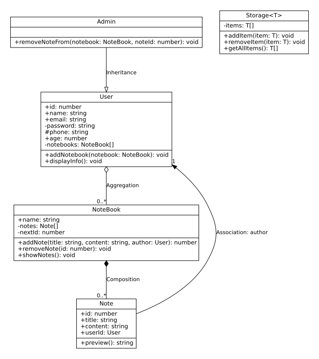

# Assignment 14 – Simple Notes Management System

Open this folder in VS Code. With Node.js 24 or later installed, run `npm start` in the terminal. The example uses only built-in functionality.

- `notes.ts` defines the five classes.
- `index.ts` creates a user and an admin, adds two notebooks, previews notes, removes a draft, and demonstrates generic storage.

## Class diagram

Admin inherits from User. User aggregates notebooks created independently. A notebook creates its own notes and manages their lifetime. Each note holds a reference to its author in userId.
